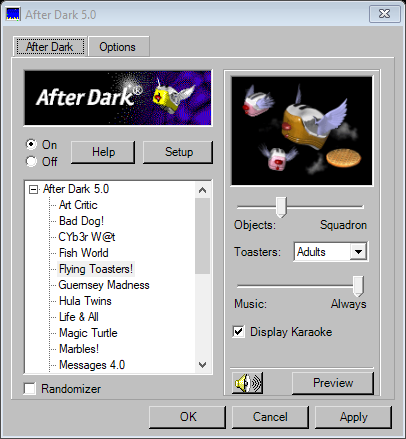
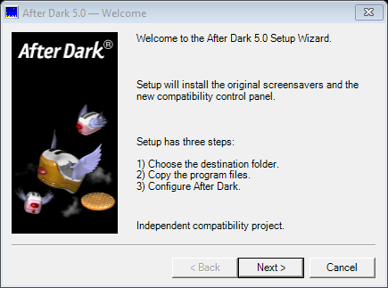
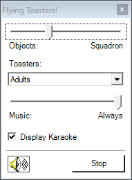

# After Dark 5.0 — English Edition

An independent compatibility control panel and installer for the original After Dark screensavers on modern Windows. Inspired by the classic interface, with a tray icon, module settings and native Windows screensaver integration.

**Pre-release.** Version 5.0 identifies this independent project, not an official Berkeley Systems release or a new version of the original modules. Original module formats and internal registry names remain unchanged for compatibility.



## Download

Open [Releases](https://github.com/gpetruzzi/after-dark-classic/releases) and select **After Dark 5.0 — English Edition**, marked **Pre-release**. Download `AfterDark-5.0-Setup-English.exe` from its assets when available.

The installer includes third-party original software and resources. Read [NOTICE.md](NOTICE.md) before using or redistributing the package.

## What's new in 5.0

- English setup wizard, control panel, tray menus, settings dialogs and project-generated error messages.
- After Dark 5.0 product branding and Windows file-version metadata.
- Compact classic setup wizard with the original artwork.
- Existing module settings and Windows screensaver preferences remain compatible.
- Updates can use the current installation folder without a prior uninstall.



## Features

- 24 original screensaver modules with 54 controls and 248 selectable options.
- Tray menu for opening the panel, starting a screensaver, toggling activation and sound, and exiting.
- Native Windows screensaver selection and timeout settings.
- Full-screen configuration preview with a floating control panel and **Stop** button.
- Automatic preview-engine reload when settings change. This briefly interrupts the animation.
- Additional fish, creature and MIDI/CD music settings for supported modules.
- Classic gray interface, original module artwork and original help text.
- File rollback if installation copying fails.
- Uninstallation removes program-owned files and empty folders, preserving settings and unrelated files.



## Install or update

1. Choose **Exit** from the current After Dark tray icon and close its previews.
2. Run `AfterDark-5.0-Setup-English.exe`.
3. To update, keep the existing installation folder suggested by Setup.
4. Complete Setup. No prior uninstall is required.

Windows permission prompts and system dialogs use your Windows language. Original modules retain their original English content.

Some internal folder and registry names still say **After Dark 4.0**. These names are required by the original engine and are intentionally preserved. The Windows uninstall entry displays **After Dark 5.0**.

## Build from source

Requirements: Windows, Windows PowerShell, and the .NET Framework 4.5-or-later compiler. The executables target x86 for compatibility with the original 32-bit engine.

```powershell
powershell -ExecutionPolicy Bypass -File .\build.ps1 -Destination .\dist
```

The full installer is generated as `dist/AfterDark-Setup.exe`. For the release asset, rename it to `AfterDark-5.0-Setup-English.exe`.

The original dependencies must be present in `package/`, including `After Dark Engine.scr`, the original DLLs, modules, artwork and music. `src/Version.cs` supplies the new version metadata. The build generates the managed screensaver launcher and control panel automatically.

## Source layout

- `src/App.cs`: main control panel and tray application.
- `src/Configure.cs`: full-screen configuration host and floating controls.
- `src/Saver.cs`: Windows screensaver launcher.
- `src/Common.cs`: settings, module catalog and Windows integration.
- `src/Setup.cs`: setup and uninstall wizard.
- `src/PackageFiles.cs`: file replacement, rollback and cleanup.
- `src/Resources.cs`: original-resource extraction utility.
- `src/Update.cs`: control-panel executable updater.
- `src/Version.cs`: 5.0 product and assembly metadata.
- `package/`: build dependencies and installed English notices.
- `docs/`: documentation and screenshots.

## Validation and limitations

Compilation, the module catalog, wizard and control-panel rendering, package extraction, file hashes, file replacement and rollback, preservation of settings and unrelated files, path containment and empty-directory cleanup have been checked. Windows settings logic has tests using in-memory storage and a simulated Windows API.

Real elevated installation, live animation and keyboard behavior, audio, and every original module still require testing on the destination computer. The project does not guarantee complete Windows or module compatibility. Keep backups of your original installation and settings.

## Attribution and third-party materials

Original After Dark modules, engine, artwork, music, sounds and help text belong to their respective owners. This project is not affiliated with or endorsed by Berkeley Systems or the current rights holders.

The original materials are **not** made open source or public domain by their inclusion here. No redistribution authorization for all original files has been verified. This disclaimer does not grant rights to those files; applicable permissions must be checked before redistributing originals or installers that contain them.

See [NOTICE.md](NOTICE.md) and [THIRD_PARTY_FILES.csv](THIRD_PARTY_FILES.csv). A license for the newly written code has not yet been selected; any future license must explicitly exclude third-party materials.

## Report an issue

Include your Windows version, project version, selected module and reproduction steps. Avoid posting personal data or original files whose redistribution is not authorized.

## Acknowledgments

Credit to Xnitro67 on YouTube, author of the original "After Dark 4.0 Settings.bat" used as the basis for this project's settings implementation.
