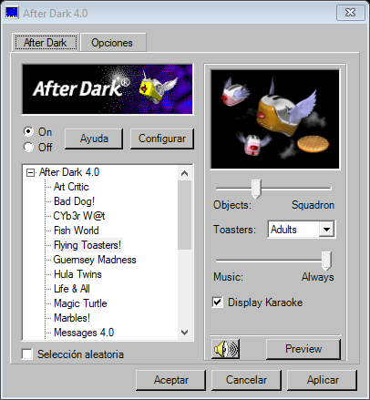

# After Dark Classic

Panel de control e instalador independientes para utilizar los módulos originales de After Dark en Windows moderno, con una interfaz inspirada en el programa clásico.

**Versión actual: 0.5, preliminar.** El proyecto está en desarrollo. La vista de configuración de esta versión y la actualización/desinstalación completas todavía requieren validación en una instalación real.



## Funciones

- Icono residente junto al reloj.
- Selección y controles para 24 módulos originales.
- Integración con el salvapantallas y el tiempo de espera de Windows.
- Panel flotante de configuración sobre una vista de pantalla completa, con botón Stop.
- Aplicación de ajustes mediante recarga automática del motor de vista previa.
- Selección de peces, criaturas y música cuando el módulo lo admite.
- Instalador de estilo clásico, con actualización sobre una instalación existente y recuperación de archivos si falla la copia.
- Desinstalación de archivos del programa y eliminación de carpetas vacías, conservando ajustes y archivos ajenos.

## Aviso sobre After Dark y los archivos originales

Este es un proyecto independiente de compatibilidad. No es una versión oficial de After Dark ni está afiliado, patrocinado o respaldado por Berkeley Systems ni por los titulares actuales de sus derechos.

After Dark, sus marcas, módulos, motor, ilustraciones, música, sonidos y textos originales pertenecen a sus respectivos titulares. No se reclama autoría ni titularidad sobre esos materiales.

**Los archivos originales no se convierten en software libre ni en dominio público por aparecer en este repositorio. Este aviso no concede ni acredita permiso para redistribuirlos.** No se ha verificado una autorización de redistribución para los materiales de terceros incluidos en el paquete local de desarrollo.

Antes de publicar esos materiales o un instalador que los contenga, deben verificarse los permisos o las licencias aplicables. Un repositorio de código puede publicarse sin incluir esos archivos, aportándolos localmente para compilar y utilizar el programa.

Consultá [el aviso completo](NOTICE.md) y [el inventario de archivos de terceros](THIRD_PARTY_FILES.csv).

## Instalar y actualizar

El instalador completo se denomina `AfterDark-Setup-0.5.exe`.

1. Elegí **Salir** desde el icono junto al reloj y cerrá las vistas previas.
2. Ejecutá el instalador completo.
3. Para actualizar, conservá la carpeta de la instalación existente. No hace falta desinstalar primero.

El instalador contiene materiales de terceros: su publicación como descarga debe revisarse por separado del código del panel.

## Compilar

Se necesitan Windows, Windows PowerShell y el compilador de .NET Framework 4.5 o posterior. La compilación genera aplicaciones x86 para utilizar el motor original de 32 bits.

Los recursos y módulos requeridos se encuentran en `package/` en el paquete local de desarrollo. Para una distribución sin esos materiales, cada usuario debe aportarlos desde una copia que esté autorizado a utilizar, respetando los nombres y rutas de `THIRD_PARTY_FILES.csv`.

```powershell
powershell -ExecutionPolicy Bypass -File .\build.ps1 -Destination .\dist
```

Los resultados se generan en `dist/`. El instalador completo es `dist/AfterDark-Setup.exe`.

## Estructura

- `src/App.cs`: panel principal y control residente.
- `src/Configure.cs`: vista de configuración y controles flotantes.
- `src/Saver.cs`: lanzador de salvapantallas para Windows.
- `src/Common.cs`: catálogo, preferencias e integración con Windows.
- `src/Setup.cs`: asistente de instalación y desinstalación.
- `src/PackageFiles.cs`: reemplazo, recuperación y limpieza de archivos.
- `src/Resources.cs`: herramienta de extracción de recursos originales.
- `src/Update.cs`: actualizador del ejecutable del panel.
- `build.ps1`: compilación y empaquetado.
- `package/`: archivos originales requeridos por la compilación local.
- `docs/`: capturas e instrucciones.

## Estado de las pruebas

Se comprobaron la compilación, el catálogo de 24 módulos y 54 controles, las pantallas del instalador, los paneles flotantes, los archivos del paquete, el reemplazo y la recuperación de archivos y la limpieza de carpetas vacías. La integración nativa tiene pruebas con almacenamiento en memoria y API simulada.

La reproducción real de cada módulo, la configuración animada, el manejo del teclado y la actualización/desinstalación con permisos de administrador requieren pruebas adicionales. El comportamiento puede variar por módulo y configuración de Windows.

El proyecto se proporciona sin promesas de compatibilidad completa ni de ausencia de errores. Conservá tus copias originales y respaldá tus ajustes antes de probar nuevas versiones.

## Licencia del código nuevo

Todavía no se seleccionó una licencia para el código nuevo del panel y del instalador. La visibilidad pública del repositorio no debe interpretarse como una licencia de software libre. Cualquier futura licencia del código nuevo deberá excluir expresamente los materiales originales de terceros.

## Informar problemas

Al abrir un issue, indicá la versión de Windows, la versión del proyecto, el módulo seleccionado y los pasos para reproducir el problema. No adjuntes claves, datos personales ni archivos originales cuya redistribución no esté autorizada.
